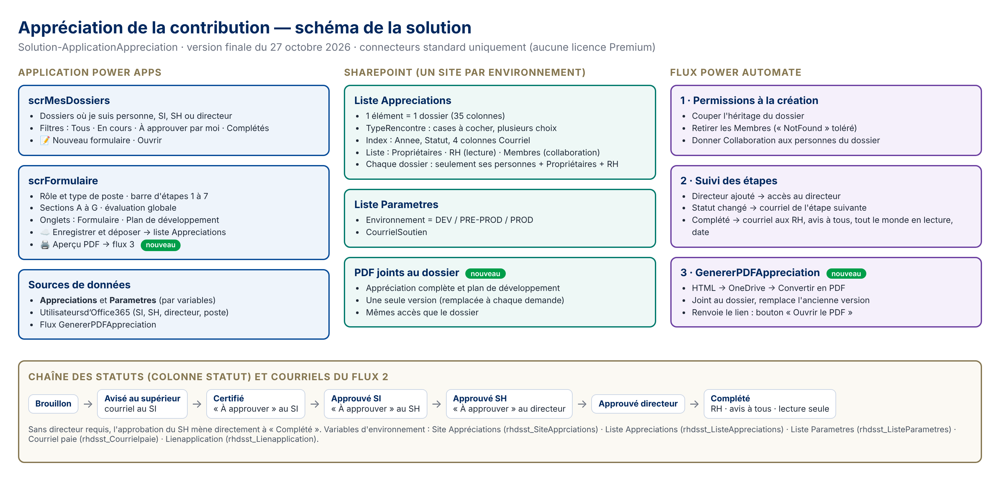

# 1. À quoi sert ce document

Ce guide complète le **« Guide complet — Application Appréciation de la contribution »** du 26 octobre 2026. Il contient :

- l'état **final et testé** de la solution dans le bac à sable (version finale du 28 octobre 2026) ;
- **toutes les corrections** apportées au guide d'origine pendant les tests (partie 3) ;
- la configuration SharePoint finale, les flux finaux et le nouveau bouton PDF ;
- la liste de vérification des tests et la **remise aux TI**.

**En cas de différence entre le Guide complet et ce document, c'est ce document qui a raison.**

## Les fichiers de la version finale

| Fichier | Contenu |
|---|---|
| `GUIDE-MISE-EN-PRODUCTION.docx` | Ce guide |
| `FORMULES-POWERAPPS-FINALES.txt` | Toutes les formules de l'application qui diffèrent du guide d'origine |
| `scrFormulaire-OnVisible-corrige.txt` | La formule complète **OnVisible** de l'écran formulaire |
| `btnApercuPDF-OnSelect.txt` | La formule complète du bouton **Aperçu PDF** |
| `CORRECTION-TYPE-RENCONTRE.docx` | Correction du 29 octobre : le type de rencontre reste dans le dossier et paraît dans le PDF |
| `MISE-A-JOUR-ECHELLE-POSTURES.docx` | Mise à jour du 30 octobre : échelle des postures de leadership à 4 niveaux |
| `transmission-TI/` | Le paquet à envoyer aux TI pour la PréProd (bordereau, courriel, ZIP) |
| `MISE-A-JOUR-28-OCTOBRE.docx` | Journal des derniers changements (PDF joint au dossier, écran allégé), étape par étape |
| `barre-etapes-formules.txt` | Les 7 formules de la barre d'étapes |
| `FLUX-FINAUX.txt` | Les 3 flux, action par action, avec les vrais noms de variables |
| `GUIDE-PDF-APPRECIATION.docx` | Le pas-à-pas détaillé du bouton PDF et du flux 3 |
| `DOSSIER-AUTORISATION-TI.docx` | Les réponses au formulaire de mise en PréProd/Prod des TI et les éléments recommandés avant la Prod |
| `communication/` | Guide d'utilisation, message d'annonce, 4 schémas opérationnels (et leur PDF) |
| `presentation/` | Présentation aux gestionnaires (.pptx et .pdf) |
| `Variables-environnement-et-deploiement.xlsx` | Variables d'environnement (dev, pré-prod, prod), structure SharePoint, composants de la solution, liste de vérification des TI |
| `schema/Schema-solution.jpg` (et `.png`) | Le schéma d'ensemble |
| `generer-formule-pdf.py`, `schema/…html`, `schema/generer-image.js` | Les sources, pour régénérer la formule PDF ou le schéma |

**Fichiers remplacés** (à supprimer de vos téléchargements) : `CORRECTIONS-FLUX-VARIABLES.docx/.txt`, `FLUX2-REORGANISER-ET-CAS-COMPLETE.docx` et `FLUX2-CAS-COMPLETE.txt`. Leur contenu est maintenant dans `FLUX-FINAUX.txt` et dans ce guide.

**L'ancienne application HTML** (dossier `sharepoint-html-kit`) est **abandonnée** : elle ne fonctionne pas dans le SharePoint de la Ville. Ses flux (« AC - Traiter un dépôt » et suivants) et ses listes (Depot_Appreciations, Journal_Appreciations, Dossiers_Appreciations, Archives_Appreciations, Config_Appreciations) peuvent être **désactivés, puis supprimés** du bac à sable. Ils ne font pas partie de la solution.

# 2. Vue d'ensemble



| Partie | Composants |
|---|---|
| Application | 2 écrans : **scrMesDossiers** et **scrFormulaire** |
| SharePoint | Liste **Appreciations** (le PDF est joint à chaque dossier), liste **Parametres** |
| Power Automate | **Permissions à la création**, **Suivi des étapes**, **GenererPDFAppreciation** (nouveau) |
| Connexions | 4 références : SharePoint Appreciation, Utilisateurs Office 365 Appreciations, Outlook Appreciations, **OneDrive Appreciations** (nouvelle) |
| Variables | 5 variables d'environnement (partie 4.3) |

Tout utilise des connecteurs **standard** : aucune licence Premium.

# 3. Corrections apportées au Guide complet (errata)

| N° | Où dans le guide | Problème rencontré | Correction |
|---|---|---|---|
| 1 | 2.3 et flux (étapes 12–13) | Les flux écrivent `Liste Appréciations (…)`, `Lien application (…)`, `Courriel paie (rhdsst_CourrielPaie)`. Les variables créées s'appellent autrement, d'où l'erreur « workflow parameter … not found ». | Utiliser les **vrais noms** (partie 4.3). Ils sont déjà corrigés dans `FLUX-FINAUX.txt`. |
| 2 | 3.2 Colonne TypeRencontre | La colonne était en « Menu déroulant » (un seul choix) et indexée. Résultat : erreur de type dans btnDeposer, et modification bloquée « en cours d'indexation ». | **Pas d'index** sur TypeRencontre. Afficher les choix en **« Cases à cocher (autoriser plusieurs sélections) »**. |
| 3 | 3.2 Autorisations de la liste | Des personnes et un groupe ajoutés à la liste étaient **recopiés** sur chaque dossier. | La liste contient **seulement** : Propriétaires (Contrôle total), RH – Appréciations (Lecture), Membres (Collaboration). |
| 4 | 4.2 Sources de données | Les sources s'appelaient « Liste Parametres » et « Liste Appreciations ». | Les noms doivent être **exactement** `Parametres` et `Appreciations`. |
| 5 | Toutes les formules avec `Office365Users` | Dans une application en français, le connecteur s'appelle `'Utilisateursd’Office365'`. | Remplacer `Office365Users` : effacer, taper « Util », choisir dans la liste. Concerne btnDeposer, txtPoste, cboDirecteur. |
| 6 | 5.1 / annexe : OnVisible | `ThisRecord.Value` à l'intérieur d'un `LookUp` causait 107 erreurs. | Formule corrigée (`As c`, `As m`, `As e`, `As v`) : `scrFormulaire-OnVisible-corrige.txt`. |
| 7 | OnVisible (ajout) | Les cases « Type de rencontre » ne se rechargeaient pas à l'ouverture d'un dossier. | Ajout de `Reset(chkEssai);; …` à la fin d'OnVisible, plus une nouvelle formule `Checked` (partie 5). |
| 8 | Annexe A.8 Barre d'étapes | Les 7 formules étaient imprimées sur une seule ligne et ont été collées ensemble dans `galEtapes.Items`. | Une formule par propriété : `barre-etapes-formules.txt`. |
| 9 | btnDeposer (TypeRencontre) | `ForAll(… {Value: Value})` était refusé par SharePoint. | `Filter(Choices(Appreciations.TypeRencontre); …)`. |
| 10 | btnDeposer (Poste) | Le poste proposé automatiquement n'était pas enregistré s'il n'avait pas été retapé. | `Poste: Coalesce(txtPoste.Text; varDossier.Poste; …MyProfileV2().jobTitle)`. |
| 11 | Champs txtNom, txtId, txtPoste, txtAutre | Les formules avaient été tapées dans le panneau de droite et s'affichaient comme du texte. | Les mettre dans la **barre fx**, propriété **Default**. |
| 12 | Onglet Synthèse (moyennes) et toutes les dates | `LookUp(colEchelle; Niveau = CoteSup)` dans `Average` était refusé. `Text(…; "fr-CA")` **et** les formats `"[$-fr-CA]d mmmm yyyy"` donnaient « Code de langue fr-CA non pris en charge ». | Formules avec `Switch` ; **aucun « fr-CA »** dans l'application (chercher `[$-fr-CA]` avec la loupe et l'effacer). Voir `FORMULES-POWERAPPS-FINALES.txt`, partie 9. |
| 18 | Bouton Aperçu PDF | Le PDF ne s'ouvrait pas : le navigateur bloque l'onglet ouvert 10 à 30 secondes après le clic. | Nouveau bouton **📄 Ouvrir le PDF** (partie 10 du fichier des formules). |
| 20 | PDF | Les PDF s'accumulaient dans une bibliothèque séparée, en plusieurs versions. | Le PDF est **joint au dossier** et **remplace** la version précédente ; il a les mêmes accès que le dossier. Bibliothèque Appreciations_PDF supprimée. |
| 21 | Onglet Plan | « Imprimer ce plan » (`Print()`) donnait une page miniature ; l'onglet a été jugé trop lourd. | **Onglet Plan de développement supprimé** (panelPlan). Le contenu reste dans les sections A et D et dans le PDF complet. |
| 22 | Écran | Trois boutons « Comment remplir » et un onglet Synthèse jugés superflus ; erreur « Average avec une table vide ». | Un seul bouton d'aide (en haut à gauche) ; **panelSynthese supprimé** ; barre d'onglets visible seulement dans l'aide (« ← Retour au formulaire »). |
| 23 | Barre d'étapes | « Transmis à la paie » | « Transmis aux RH » |
| 24 | Flux 3, réponse | La sortie « lien » contenait le texte tapé « URI absolu… » au lieu de l'adresse. | Expression `body('Ajouter_PDF')?['AbsoluteUri']`. |
| 25 | Flux 3, anciennes versions | La Condition comparait le nom OneDrive (.html), d'où « Le nom spécifié est déjà utilisé ». | Expression `concat(triggerBody()?['text'], '.pdf')`. |
| 26 | panelOnglets.Height | Référençait les panneaux supprimés. | `20 + If(panelAide.Visible; panelAide.Height; 0) + 20` |
| 27 | Cases Type de rencontre (29 oct.) | Les cases se décochaient après « Enregistrer et déposer » et le type de rencontre n'était pas dans le PDF : le texte exact des choix ne correspondait pas, ou le dossier ouvert depuis Mes dossiers arrivait incomplet. | Comparaison par **mot-clé** (`"essai" in Value`…) dans Checked et dans btnDeposer ; **relecture du dossier** au début d'OnVisible. Voir `CORRECTION-TYPE-RENCONTRE.docx`. |
| 28 | Section B, échelle (30 oct.) | Nouvelle échelle des postures de leadership : 4 niveaux (Insatisfaisant, Partiellement satisfaisant, Complètement satisfaisant, Supérieur), nouvelles descriptions et note 1. | `colEchelle` à 4 niveaux avec descriptions (OnVisible) ; `echelleLegend` lit colEchelle. Voir `MISE-A-JOUR-ECHELLE-POSTURES.docx`. |
| 19 | Tests avec d'autres comptes | « You are not a member of the environment's security group » | Normal dans le bac à sable : seules les personnes du **groupe de sécurité** de l'environnement peuvent ouvrir l'application. Les TI doivent y ajouter les testeurs, et prévoir le bon groupe en pré-prod et en prod. |
| 13 | Flux 1, action 4 | « Retirer les Membres » échoue (404 NotFound) quand les Membres n'ont pas de droit sur le dossier, et le flux s'arrêtait. | Sur « Personnes du dossier » : Configurer l'exécution après = **a réussi + a échoué**. |
| 14 | Flux 2, structure | « Statut changé » était placée **dans** « Directeur ajouté », et « Date paie » était **hors** du cas Complété. | Structure corrigée (partie 6.2). |
| 15 | Bouton Aperçu PDF | Il ouvrait l'onglet Plan, et `Print()` n'imprimait qu'une page miniature. | Nouveau flux 3 et nouvelle formule : un vrai PDF de plusieurs pages (partie 7). |
| 16 | Mise en page | Grand espace sous l'Introduction, contenu collé au bord, boutons « + Ajouter une ligne » coupés. | Hauteur automatique sur le texte d'introduction, remplissage 16 sur les cartes, `+ 16` à la fin de la hauteur des cartes A et D. |
| 17 | Écran Mes dossiers | « + Nouveau dossier » n'indiquait pas qu'il ramène au formulaire. | Texte : « 📝 Nouveau formulaire », largeur 230. |

# 4. SharePoint — configuration finale (à refaire à l'identique sur chaque site)

Le détail est aussi dans l'onglet **SharePoint** du fichier Excel.

## 4.1 Liste Appreciations

- Les 35 colonnes de l'étape 3.2 du Guide complet, avec les **mêmes noms internes**.
- **TypeRencontre** : Choix, avec ces 5 choix exactement :
  - Période d'essai ou progression salariale ;
  - Première rencontre annuelle ;
  - Bilan de mi-année ;
  - Bilan annuel ;
  - Autre.

  **Afficher les choix au moyen de : Cases à cocher (autoriser plusieurs sélections).**
- **Colonnes indexées (6)** : Annee, Statut, CourrielPersonne, CourrielSI, CourrielSH, CourrielDirecteur. **Jamais TypeRencontre.**
- **Autorisations de la liste** (héritage arrêté) :

| Qui | Niveau |
|---|---|
| Propriétaires du site | Contrôle total |
| RH – Appréciations | Lecture |
| Membres du site | Collaboration (pour créer leur dossier) |
| Toute autre personne ou tout autre groupe | **à retirer** |

- **Contrôle** : chaque nouveau dossier, dans **… › Gérer l'accès**, ne montre que les Propriétaires, RH – Appréciations et les personnes du dossier.

## 4.2 Liste Parametres

**Liste Parametres** : une colonne **Valeur**, et 2 lignes :

| Titre | Valeur |
|---|---|
| Environnement | DEV, PRE-PROD ou PROD |
| CourrielSoutien | l'adresse de soutien |

Héritage conservé.

**Pièces jointes :** la liste Appreciations doit accepter les pièces jointes (Paramètres avancés › Pièces jointes = Activé, réglage par défaut). Le PDF de chaque dossier y est joint par le flux 3.

## 4.3 Les 5 variables d'environnement (noms réels)

| Nom d'affichage | Nom de schéma | Comment l'écrire dans une expression de flux |
|---|---|---|
| Site Appréciations | `rhdsst_SiteApprciations` | `parameters('Site Appréciations (rhdsst_SiteApprciations)')` |
| Liste Appreciations | `rhdsst_ListeAppreciations` | `parameters('Liste Appreciations (rhdsst_ListeAppreciations)')` |
| Liste Parametres | `rhdsst_ListeParametres` | `parameters('Liste Parametres (rhdsst_ListeParametres)')` |
| Courriel paie | `rhdsst_Courrielpaie` | `parameters('Courriel paie (rhdsst_Courrielpaie)')` |
| Lienapplication | `rhdsst_Lienapplication` | `parameters('Lienapplication (rhdsst_Lienapplication)')` |

Ne les renommez pas : le nom de schéma ne peut plus changer, et les flux corrigés en dépendent. Les valeurs pour la pré-prod et la prod sont dans l'onglet **Variables** du fichier Excel.

# 5. Application Power Apps — ce qui change

Toutes les formules sont dans **`FORMULES-POWERAPPS-FINALES.txt`**, classées par contrôle :

1. **Identification** : propriété Default de txtNom, txtId, txtPoste, txtAutre.
2. **Type de rencontre** : propriété Checked des 5 cases.
3. **btnDeposer.OnSelect** : la formule complète.
4. **cboDirecteur.Items**.
5. **Écran allégé** : panelSynthese et panelPlan **supprimés** ; panelOnglets.Height et tabBar.Visible corrigés ; aideCallout masqué.
6. **Barre d'étapes** : galEtapes et ses 6 contrôles.
7. **Mes dossiers** : bouton « 📝 Nouveau formulaire » (et, en option, bouton « 📄 PDF » sur chaque ligne).
8. **Mise en page** : Introduction, remplissages, hauteurs.
9. **Dates** : aucun « fr-CA » dans l'application.
10. **PDF** : btnApercuPDF et btnOuvrirPDF.

Les deux formules les plus longues sont dans leurs propres fichiers :

- **scrFormulaire.OnVisible** → `scrFormulaire-OnVisible-corrige.txt` (avec les `Reset` des cases à la fin) ;
- **btnApercuPDF.OnSelect** → `btnApercuPDF-OnSelect.txt`.

**Règles à retenir :**

- Toujours coller dans la **barre fx**, jamais dans le panneau de droite.
- Le Vérificateur d'application (🩺) doit afficher **Formules : 0** avant l'export. Les avertissements d'accessibilité et de performances ne bloquent pas.
- Après toute modification d'un flux utilisé par l'application : volet **Power Automate**, puis **… › Actualiser**.

# 6. Flux Power Automate — version finale

Le détail champ par champ des 3 flux est dans **`FLUX-FINAUX.txt`**.

## 6.1 Flux 1 — Appréciation – Permissions à la création

Id dossier → Couper l'héritage → Groupe Membres → Retirer les Membres → **Personnes du dossier** → Pour chaque personne (Assurer utilisateur → Donner Collaboration).

- « Personnes du dossier » s'exécute après « Retirer les Membres » **réussi ou échoué**.
- Une carte rouge **« NotFound »** sur « Retirer les Membres » est **normale** si le flux finit par « Votre flux a été correctement exécuté ».

## 6.2 Flux 2 — Appréciation – Suivi des étapes

```
LienApp → CourrielPaie → Changements
→ Directeur ajouté  (Si oui : Assurer directeur → Accès directeur)
→ Statut changé     (Si oui : Selon le statut)
      ├ Avisé au supérieur : courriel au SI
      ├ Certifié : courriel au SI
      ├ Approuvé SI : courriel au SH
      ├ Approuvé SH : courriel au directeur
      └ Complété : Courriel paie → Avis à tous → Personnes finales
                   → Lecture seule (Assurer personne → Retirer accès → Donner Lecture)
                   → Date paie
```

« Statut changé » est **sous** « Directeur ajouté », pas dedans. « Date paie » est la **dernière** action du cas Complété.

## 6.3 Flux 3 — GenererPDFAppreciation

Voir la partie 7.

# 7. Le bouton Aperçu PDF

Le pas-à-pas complet est dans **`GUIDE-PDF-APPRECIATION.docx`**. En résumé :

1. Vérifier que la liste Appreciations accepte les pièces jointes (partie 4.2).
2. Créer le flux **GenererPDFAppreciation** dans la solution : 3 entrées (nomFichier, html, idDossier) et 7 actions ; il **joint le PDF au dossier** en remplaçant l'ancienne version (voir `FLUX-FINAUX.txt` et `MISE-A-JOUR-28-OCTOBRE.docx`). Il convertit avec **OneDrive Entreprise › Convertir un fichier**, crée la référence de connexion **OneDrive Appreciations**, et répond avec une sortie **lien**.
3. Dans l'application, ajouter le flux, coller `btnApercuPDF-OnSelect.txt` dans **btnApercuPDF.OnSelect**, puis créer le bouton **« 📄 Ouvrir le PDF »** (barre de gauche, sous Aperçu PDF). Le bouton « 📄 PDF » sur chaque ligne de Mes dossiers est **optionnel** (amélioration future).

**Point clé du flux :** la sortie **lien** de « Répondre à l'application » doit être l'expression `body('Ajouter_PDF')?['AbsoluteUri']` (une pastille), jamais du texte tapé. La Condition des anciennes versions compare **DisplayName** à `concat(triggerBody()?['text'], '.pdf')`.

La formule assemble le document **en 40 petites étapes**, dans la variable `varHtmlPDF`. Une seule longue formule donnait l'erreur « L'imbrication d'expressions est trop profonde ».

Le PDF reprend ce qui est à l'écran, à **toute étape**. Il contient :

- l'identification et les participants ;
- les sections A à F (postures ou compétences selon le type de poste) ;
- l'évaluation globale ;
- le tableau des avis, de la certification et des approbations.

Le dossier doit avoir été enregistré au moins une fois.

# 8. Tests avant la remise (bac à sable), à refaire en pré-prod

| N° | Test | Résultat attendu | ✓ |
|---|---|---|---|
| 1 | Vérificateur d'application | Formules : 0 | |
| 2 | Personne : nouveau formulaire, Identification, type de rencontre, section A, Enregistrer et déposer | Message vert ; ligne dans Appreciations avec Poste, TypeRencontre, SI et SH remplis | |
| 3 | Flux 1 sur ce dossier | « Correctement exécuté » ; Gérer l'accès = Propriétaires, RH, personnes du dossier seulement | |
| 4 | Collègue sans lien | Ne voit pas le dossier dans Mes dossiers | |
| 5 | Fermer, puis rouvrir le dossier | Tout revient, y compris les cases Type de rencontre (2 cases cochées restent cochées) | |
| 6 | Saisie dans les tableaux (Objectifs, Indicateurs) | Le texte ne saute pas | |
| 7 | Aviser le supérieur | Le SI reçoit le courriel ; le lien ouvre le bon dossier | |
| 8 | Certifier | Contenu verrouillé ; le SI reçoit « À approuver » | |
| 9 | SI : cotes, section E, évaluation globale, Approuver | Le SH reçoit « À approuver » | |
| 10 | SH : Approuver (sans directeur) | Statut Complété ; Courriel paie reçu ; tous avisés ; tout le monde en Lecture ; TransmisPaieLe rempli | |
| 11 | Dossier avec directeur requis | Le directeur reçoit l'accès dès qu'il est choisi, puis le courriel après le SH | |
| 12a | Section B (cadres avec et sans équipe) | Tableau à 4 niveaux et note 1 ; les listes de cotes offrent les 4 niveaux ; les cotes reviennent à la réouverture | |
| 12 | Écran allégé | Un seul bouton d'aide ; plus d'onglets Synthèse ni Plan ; aucune erreur dans le Vérificateur | |
| 13 | Barre d'étapes | Chaque étape passe au vert avec sa date | |
| 14 | Aperçu PDF, puis « 📄 Ouvrir le PDF » | Le PDF de plusieurs pages s'ouvre et affiche le **type de rencontre** ; il est joint au dossier (une seule version) ; aucun .html ne reste dans OneDrive | |
| 15 | Aperçu PDF par un collègue sans lien sur le PDF d'un autre | Accès refusé | |

Pour les tests de courriels, utilisez des comptes de test, ou mettez temporairement votre adresse dans les colonnes Courriel du dossier de test.

# 9. Remise aux TI

## 9.1 Préparer la solution (bac à sable)

1. **Solution › Objets** : vérifier qu'elle contient :
   - l'application ;
   - les **3 flux** ;
   - les **5 variables** ;
   - les **4 références de connexion**.

   S'il manque un élément : **Ajouter existant**.
2. Pour chacune des 5 variables : ouvrez-la, puis sous **Valeur actuelle**, faites **… › Retirer de cette solution**. Laissez la valeur par défaut vide.
3. **Publier toutes les personnalisations.**
4. Augmentez la **version** (ex. 1.0.0.3 pour la remise du 30 octobre).

## 9.2 Exporter

1. **Exporter la solution**, puis **Vérifier**.
2. Choisissez **Gérée**, puis **Exporter**.
3. Téléchargez le .zip (ex. `Solution-ApplicationAppreciation_1_0_0_3_managed.zip`).

## 9.3 Remettre aux TI

Tout est prêt dans le dossier **`transmission-TI/`** :

- `BORDEREAU-TRANSMISSION-TI.docx` : le contenu du paquet, le courriel à envoyer et la marche à suivre ;
- `Transmission-TI-PreProd.zip` : les documents pour les TI.

**À ajouter vous-même** : le **.zip géré de la solution** (partie 9.2). Il ne peut venir que de votre environnement Power Apps.

**Recréer les listes SharePoint à l'identique :** sur le site de PréProd, **Nouveau › Liste › À partir d'une liste existante**, puis choisir la liste *Appreciations* du bac à sable (même chose pour *Parametres*). Les 35 colonnes, avec leurs noms internes et leurs choix, sont recopiées exactement. Ensuite, refaire les réglages de l'onglet **SharePoint** du fichier Excel : index, pièces jointes, versions, autorisations.

## 9.4 Ce que font les TI (pré-prod, puis prod)

Voir l'onglet **Checklist TI** du fichier Excel :

1. Créer les listes et le groupe RH.
2. Remplir la liste Parametres.
3. Importer la solution.
4. Choisir les connexions du compte de service (**4** références).
5. Saisir les variables, puis le lien de l'application.
6. Activer les 3 flux.
7. Partager l'application.
8. Faire les tests de la partie 8.

## 9.5 Mises à jour futures

1. Modifier **seulement** dans le bac à sable.
2. Tester.
3. Augmenter la version et exporter en gérée.
4. Les TI importent en **Mise à niveau**. Les valeurs des variables, les connexions et les données SharePoint sont conservées.

# 10. Dépannage — les messages déjà rencontrés

| Message | Cause | Solution |
|---|---|---|
| « The workflow parameter '…' is not found » | Mauvais nom de variable dans un flux | Noms de la partie 4.3 |
| « Impossible de trouver le principal dont l'ID est 5 » | Les Membres n'ont pas de droit sur le dossier | Normal : exécution après « a échoué » (partie 6.1) |
| « Impossible de modifier le type de cette colonne car il est en cours d'indexation » | Colonne indexée | Supprimer l'index (Paramètres de la liste › Colonnes indexées) |
| « Le type de cet argument 'TypeRencontre' ne correspond pas » | Colonne à choix unique | Cases à cocher (plusieurs sélections), puis Actualiser la source |
| « Code de langue fr-CA non pris en charge » | `Text(…; "fr-CA")` ou un format `[$-fr-CA]` | Retirer « fr-CA » partout (loupe › `[$-fr-CA]`) |
| Le PDF est créé, mais ne s'ouvre pas | Ouverture d'onglet bloquée par le navigateur | Bouton « 📄 Ouvrir le PDF » |
| « You can't open apps in this environment… security group » | Le compte n'est pas dans le groupe de sécurité de l'environnement | Demander aux TI d'ajouter la personne (ou le groupe des utilisateurs) |
| « L'imbrication d'expressions est trop profonde » | Formule trop longue d'un bloc | Formule PDF en étapes (`btnApercuPDF-OnSelect.txt`) |
| « Value n'est pas reconnu » | `ThisRecord` dans un LookUp | Formules avec `As` (OnVisible corrigé) |
| Le champ affiche la formule au lieu de la valeur | Formule tapée dans le panneau de droite | Barre fx, propriété Default |
| `.lien` souligné en rouge | Le flux 3 a été ajouté avant sa dernière action, ou ses entrées ont changé | Volet Power Automate › … › Actualiser (ou supprimer et rajouter le flux) |
| « 502 BadGateway / NoResponse » | Le flux n'a pas atteint « Répondre » (une action a échoué) | Historique des exécutions › carte rouge. Une erreur Runtime ancienne reste affichée tant qu'il n'y a pas d'appel réussi |
| « Le nom spécifié est déjà utilisé » (Ajouter PDF) | L'ancien PDF n'a pas été supprimé | Condition = `concat(triggerBody()?['text'], '.pdf')` |
| « ActionResponseSkipped » | Exécution relancée par « Renvoyer » : personne n'attend la réponse | Normal ; tester depuis l'application |
| « Impossible d'utiliser la fonction Average avec une table vide » | Contrôles de l'ancien onglet Synthèse | Supprimer panelSynthese |
