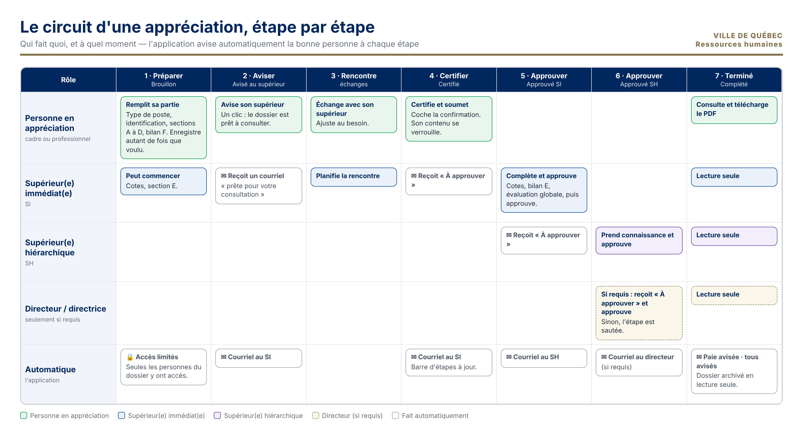
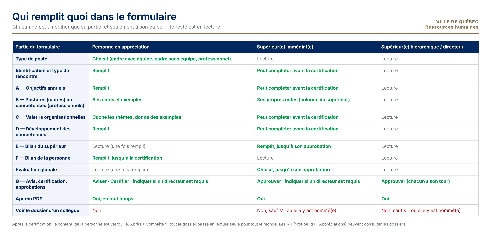

# En bref

L'appréciation de la contribution se fait maintenant **dans une application**, et non plus dans un document Word.

- **Un seul dossier** par appréciation, conservé dans SharePoint de la Ville.
- **Vous ne voyez que vos dossiers** : ceux où vous êtes la personne en appréciation, son supérieur ou son directeur.
- **L'application avise automatiquement** la bonne personne à chaque étape, par courriel.
- **Aucun fichier à envoyer** par courriel.

**Pour ouvrir l'application :** *[lien de l'application]*. Vous pouvez l'ajouter à vos favoris. Elle s'ouvre dans votre navigateur, avec votre compte de la Ville, sans mot de passe à créer.

# 1. L'écran « Mes dossiers »

C'est l'écran d'accueil. Vous y voyez **toutes les appréciations qui vous concernent**, avec votre rôle, le statut et la date de la dernière modification.

| Élément | À quoi il sert |
|---|---|
| **Rechercher un nom** | Trouver un dossier par le nom de la personne |
| **Tous · En cours · À approuver par moi · Complétés** | Filtrer la liste. **« À approuver par moi »** montre les dossiers qui attendent **votre** action |
| **Ouvrir** | Ouvrir le dossier |
| **📝 Nouveau formulaire** | Commencer **votre** appréciation (personne en appréciation seulement) |

# 2. Personne en appréciation : vos étapes

## Étape 1 — Commencer et remplir

1. Cliquez sur **📝 Nouveau formulaire**.
2. En haut à gauche, **« Vous êtes »** indique **Personne en appréciation**.
3. Choisissez votre **type de poste** :
   - **Cadre avec équipe** ;
   - **Cadre sans équipe** ;
   - **Professionnel non syndiqué**.

   L'application affiche le formulaire qui correspond.
4. Vérifiez l'**identification**. Votre nom et votre poste sont proposés automatiquement : corrigez-les au besoin. Inscrivez votre **ID** et cochez le **type de rencontre**.
5. Remplissez les sections :
   - **A** : vos objectifs de l'année en cours et de l'année à venir. Utilisez **+ Ajouter une ligne** au besoin.
   - **B** : vos postures de leadership (cadres) ou vos compétences (professionnels), avec vos cotes et vos exemples.
   - **C** : cochez les thèmes ayant fait l'objet d'actions particulières, et donnez des exemples.
   - **D** : vos actions de développement passées et vos nouveaux besoins.
   - **F** : votre bilan de l'année.
6. Cliquez sur **☁️ Enregistrer et déposer**. Un message vert confirme l'enregistrement.

> 💡 **Enregistrez souvent.** Vous pouvez fermer l'application et revenir plus tard : ouvrez le dossier dans **Mes dossiers**. Votre **supérieur(e) immédiat(e)** et votre **supérieur(e) hiérarchique** sont trouvés automatiquement dans l'annuaire, au premier enregistrement.

> ❓ Le bouton **Comment remplir ce formulaire** (en haut à gauche) explique chaque section en 2 minutes.

## Étape 2 — Aviser votre supérieur(e)

Quand votre partie est prête :

1. Allez à la **section G**.
2. Cliquez sur le bouton **Aviser**.

Votre supérieur(e) immédiat(e) reçoit un courriel avec un lien vers votre dossier. **Vous pouvez encore modifier** votre contenu ensuite.

## Étape 3 — La rencontre

Vous échangez avec votre supérieur(e). Ajustez votre dossier au besoin, puis **enregistrez**.

**Si un directeur ou une directrice doit approuver :** dans la section G, cochez **« Approbation du directeur requise »** et choisissez la personne. Ce choix est possible jusqu'à la certification.

## Étape 4 — Certifier et soumettre

1. Dans la **section G**, cochez la case de confirmation.
2. Cliquez sur **Certifier**.

**À partir de ce moment, votre contenu est verrouillé.** Votre supérieur(e) immédiat(e) reçoit « À approuver ».

## Ensuite

Vous suivez l'avancement dans la **barre d'étapes**, en haut du formulaire. Quand le dossier est **Complété** :

- vous recevez un courriel ;
- le dossier passe en **lecture seule** ;
- vous pouvez en tout temps produire le **PDF**.

# 3. Supérieur(e) immédiat(e)

1. Vous recevez un **courriel** : « prête pour votre consultation » après l'avis, puis « À approuver » après la certification. Cliquez sur le lien, ou ouvrez **Mes dossiers › À approuver par moi**.
2. L'application reconnaît votre rôle **automatiquement** : « Vous êtes : Supérieur(e) immédiat(e) ».
3. Avant la certification, vous pouvez compléter :
   - l'identification ;
   - les sections A, C et D ;
   - les commentaires de la section B.
4. Jusqu'à **votre approbation**, vous remplissez :
   - **vos cotes** dans la section B (colonne du supérieur) ;
   - le **bilan annuel (section E)** ;
   - l'**évaluation globale**.
5. Après la certification, allez à la **section G**, cochez la case de confirmation et cliquez sur **Approuver**.
6. Le supérieur hiérarchique reçoit alors « À approuver ».

# 4. Supérieur(e) hiérarchique et directeur ou directrice

1. Vous recevez « À approuver » par courriel, avec le lien vers le dossier.
2. Prenez connaissance du dossier. Les onglets **📊 Synthèse** et **🎯 Plan de développement** en donnent un résumé.
3. Dans la **section G**, cochez la case de confirmation et cliquez sur **Approuver**.

- **Sans directeur requis :** l'approbation du supérieur hiérarchique **termine** le dossier (statut « Complété »).
- **Avec directeur requis :** le directeur ou la directrice reçoit « À approuver » et approuve en dernier.

**À « Complété », tout est automatique :**

- l'évaluation globale est transmise à la **paie** ;
- tout le monde est avisé ;
- le dossier passe en **lecture seule**.

# 5. Les outils pratiques

| Outil | Où | À quoi il sert |
|---|---|---|
| **Barre d'étapes** | En haut du formulaire | Les 7 étapes, avec un ✓ et la date quand elles sont faites |
| **📊 Synthèse** | Onglet | Statut, type de poste, évaluation globale, nombre d'objectifs, moyenne des cotes par posture |
| **🎯 Plan de développement** | Onglet | Objectifs à venir et besoins de développement, réunis sur une page |
| **🖨️ Aperçu PDF** | Barre de gauche | Produit le **PDF complet** de l'appréciation (10 à 30 secondes). Il s'ouvre dans un nouvel onglet |
| **🗑️ Nouveau formulaire** | Barre de gauche | Vide l'écran pour commencer un autre formulaire. Ce qui a été enregistré n'est pas effacé |
| **📂 Mes dossiers** | Barre de gauche | Revenir à la liste de vos dossiers |

# 6. Questions fréquentes

| Question | Réponse |
|---|---|
| Je ne vois pas le dossier de mon employé. | Il apparaît dès que la personne a fait son premier **Enregistrer et déposer**. Vérifiez aussi le filtre **Tous**. |
| Mon supérieur immédiat affiché n'est pas le bon. | Il vient de l'annuaire de la Ville. Écrivez au soutien (en bas de page) pour faire corriger le dossier. |
| Je ne peux plus modifier mon contenu. | Il est verrouillé depuis la **certification**. Pour une correction, parlez-en à votre supérieur(e) et au soutien RH. |
| Une section est grisée. | Elle est réservée à un autre rôle, ou à une autre étape. |
| Le bouton Approuver est grisé. | Cochez d'abord la case de confirmation juste au-dessus. |
| Le PDF ne s'ouvre pas. | Vérifiez que votre navigateur autorise les fenêtres. Si un message rouge apparaît, réessayez dans une minute, puis contactez le soutien. |
| Qui voit mon appréciation ? | Vous, votre supérieur(e) immédiat(e), votre supérieur(e) hiérarchique, le directeur ou la directrice si requis, et l'équipe RH responsable. **Personne d'autre.** |
| Est-ce que le courriel contient mon évaluation ? | Non. Les courriels contiennent seulement un lien. Seule l'**évaluation globale** est transmise à la paie, à la fin. |

# 7. Besoin d'aide ?

- Dans l'onglet **❓ Comment remplir**, utilisez le bouton de contact pour écrire à l'équipe.
- Soutien RH : *[adresse de soutien]*.
