# 1. Objet de la demande

Les Ressources humaines (RH-SST) lancent l'application **Appréciation de la contribution**, qui sera utilisée par **plus de 500 cadres et professionnels** de la Ville. Avant le déploiement, nous demandons au Service des communications de **valider l'image visuelle** de l'outil et de ses documents.

**Ce que nous vous demandons de valider :**

1. **La palette de couleurs** (partie 2) : codes, usages, contraste.
2. **Les polices** (partie 3).
3. **Les éléments graphiques**, dont le bandeau de marque « On donne vie à la ville » (partie 4).
4. **L'application**, à partir des captures d'écran (partie 5).
5. **Le PDF produit par l'application** (partie 6).
6. **Les visuels de communication et la présentation** (partie 7).
7. **Les textes de l'interface** (partie 8).

La **grille de validation** est à la partie 10. Merci de nous la retourner avec vos commentaires.

**Contact :** Annie Audet, conseillère en ressources humaines, RH-SST.

# 2. Palette de couleurs

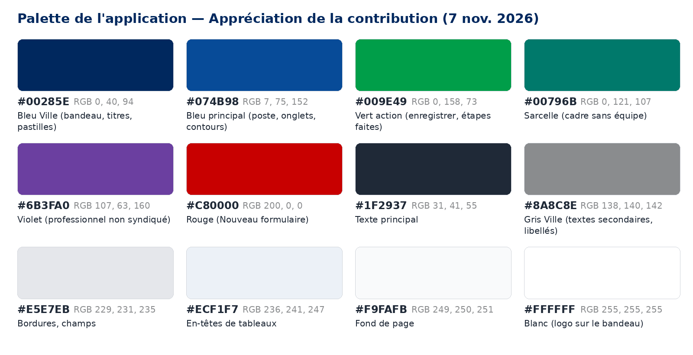

Les codes ont été relevés dans l'application et dans ses fichiers de style.

| Couleur | HEX | Usage | Contraste (blanc) |
|---|---|---|---|
| Or Ville | **#857650** | Bandeau du haut, bouton « Comment remplir », filets du PDF et des visuels | 4,46 : 1 (texte blanc) |
| Marine | **#00285E** | Titres de sections, titres du PDF | 14,33 : 1 ✔ |
| Bleu principal | **#074B98** | Pastille du type de poste, onglets, boutons à contour (Mes dossiers, Aperçu PDF, + Ajouter une ligne), « Cadre avec équipe » | 8,51 : 1 ✔ |
| Vert action | **#009E49** | « Enregistrer et déposer », rôle actif, étapes faites, pastille du rôle | 3,51 : 1 ⚠ |
| Sarcelle | **#00796B** | « Cadre sans équipe » | 5,32 : 1 ✔ |
| Violet | **#6B3FA0** | « Professionnel non syndiqué » | 7,38 : 1 ✔ |
| Rouge | **#C80000** | Bouton « Nouveau formulaire » (contour et texte) | 6,08 : 1 ✔ |
| Texte principal | **#1F2937** | Texte courant | 14,68 : 1 ✔ |
| Texte secondaire | **#6B7280** | Notes, sous-titres, aide | 4,83 : 1 ✔ |
| Gris libellés | **#9CA3AF** | Titres du menu (« VOUS ÊTES : »), étapes à venir | 2,54 : 1 ⚠ |
| Gris bordures | **#E5E7EB** | Bordures des champs et des cartes | — |
| Bleu pâle | **#ECF1F7** | En-têtes de tableaux, tableau de l'échelle | — |
| Fond de page | **#F9FAFB** | Fond derrière les cartes | — |

**Codes RGB et format Power Apps** (à inscrire dans l'application si une couleur change) :

| Couleur | RGB | Format Power Apps |
|---|---|---|
| Or Ville **#857650** | 133, 118, 80 | RGBA(133; 118; 80; 1) |
| Marine **#00285E** | 0, 40, 94 | RGBA(0; 40; 94; 1) |
| Bleu principal **#074B98** | 7, 75, 152 | RGBA(7; 75; 152; 1) |
| Vert action **#009E49** | 0, 158, 73 | RGBA(0; 158; 73; 1) |
| Sarcelle **#00796B** | 0, 121, 107 | RGBA(0; 121; 107; 1) |
| Violet **#6B3FA0** | 107, 63, 160 | RGBA(107; 63; 160; 1) |
| Rouge **#C80000** | 200, 0, 0 | RGBA(200; 0; 0; 1) |
| Texte principal **#1F2937** | 31, 41, 55 | RGBA(31; 41; 55; 1) |
| Texte secondaire **#6B7280** | 107, 114, 128 | RGBA(107; 114; 128; 1) |
| Gris libellés **#9CA3AF** | 156, 163, 175 | RGBA(156; 163; 175; 1) |
| Gris bordures **#E5E7EB** | 229, 231, 235 | RGBA(229; 231; 235; 1) |
| Bleu pâle **#ECF1F7** | 236, 241, 247 | RGBA(236; 241; 247; 1) |
| Fond de page **#F9FAFB** | 249, 250, 251 | RGBA(249; 250; 251; 1) |

**Accessibilité (WCAG 2.1 AA, texte normal : 4,5 : 1 minimum)** :

- **Vert action :** texte blanc sur vert (#009E49) = 3,51 : 1, **sous le seuil** pour du texte normal. Le texte des boutons est en gras ; à valider, ou foncer le vert (ex. #007A38).
- **Gris libellés :** #9CA3AF sur blanc = 2,54 : 1, **sous le seuil**. Proposition : #6B7280.
- **Or Ville :** texte blanc = 4,46 : 1, à la limite. Le titre du bandeau est grand et gras (seuil de 3 : 1 pour le grand texte) : conforme.

# 3. Polices

| Support | Police | Détail |
|---|---|---|
| **Application** (Power Apps) | **Open Sans**, police par défaut des contrôles Power Apps *(à confirmer dans l'application, propriété Font)* | Titre du bandeau : gras, ~20 pt ; titres de sections : gras, ~16 pt ; texte : 11 à 13 pt ; boutons : gras (Semibold), ~11 pt |
| **PDF** produit par l'application | **Segoe UI**, puis Arial | Titre 18 pt marine ; titres de sections 12,5 pt marine avec filet or ; sous-titres 11 pt bleu ; texte 10 pt ; tableaux 9,5 pt |
| **Schémas et visuels** (images JPG/PNG) | **Segoe UI**, puis Arial | Titres 24 px gras marine ; texte 12 à 16 px |
| **Présentation** aux gestionnaires (PowerPoint) | **Cambria** (titres), **Calibri** (texte) | Polices Office standard |
| **Guides Word** | Police par défaut de Word | — |

> **À valider :** la Ville a-t-elle une police institutionnelle à utiliser dans les outils numériques internes ? Si oui, nous l'appliquerons à l'application et aux documents.

# 4. Éléments graphiques

| Élément | Description | À valider |
|---|---|---|
| **Bandeau de marque** « ON DONNE VIE À LA VILLE » | Image placée sous le titre de l'application (lettrage orange, noir, violet, rose et bleu) | Droit d'utilisation et **version à jour** de la signature ; place dans un outil interne RH |
| **Bandeau or** | Barre or (#857650) en haut, titre blanc centré « Appréciation de la contribution » et sous-titre « Formulaire : [type de poste] » | Couleur et typographie |
| **Pastilles** | Coins très arrondis : statut (gris, texte marine), type de poste (bleu, texte blanc), rôle (vert, texte blanc, en haut à droite) | — |
| **Boutons** | Pleins : vert (Enregistrer et déposer, rôle actif) et or (Comment remplir). À contour : bleu (Mes dossiers, Aperçu PDF, + Ajouter une ligne) et rouge (Nouveau formulaire). Coins arrondis | Hiérarchie des boutons |
| **Barre d'étapes** | 7 cercles reliés par une ligne : vert avec ✓ quand l'étape est faite, gris avec le numéro sinon, avec la date sous l'étape | — |
| **Repères de couleur des types de poste** | Petite barre verticale à gauche de chaque choix : bleu (avec équipe), sarcelle (sans équipe), violet (professionnel) | — |
| **Icônes** | Émojis standards : 📝 Nouveau formulaire, ☁️ Enregistrer, 📂 Mes dossiers, 🖨️ Aperçu PDF, 📄 Ouvrir le PDF, ❓ Aide, ℹ️ À propos, 👤 rôle | Remplacer par la banque d'icônes de la Ville ? |
| **Logo de la Ville** | Non utilisé dans l'application (seulement le bandeau de marque) | Faut-il l'ajouter (écran À propos, PDF) ? |

# 5. Captures d'écran de l'application

> Ces captures ont été prises pendant les tests. Depuis : les onglets « Plan de développement » et « Synthèse » ont été retirés, l'étape 6 s'appelle « Transmis aux RH », et les écrans « À propos » et « Aide » s'ajoutent. **Les couleurs, polices et éléments graphiques sont inchangés.**

**5.1 En-tête, menu de gauche, bandeau de marque et barre d'étapes**

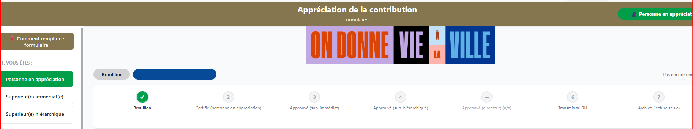

**5.2 Sections du formulaire, tableaux et boutons**

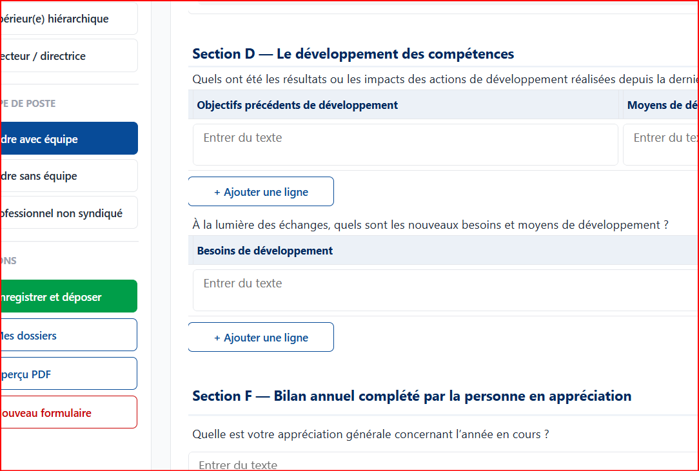

**5.3 Section B : tableau de l'échelle**

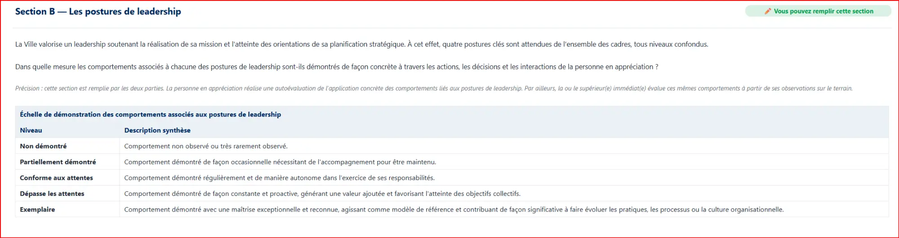

# 6. Le PDF produit par l'application

Le bouton « Aperçu PDF » produit un PDF complet de l'appréciation, joint au dossier.

| Élément | Style |
|---|---|
| Police | Segoe UI, puis Arial ; 10 pt ; texte #1F2937 |
| Titre | 18 pt, marine #00285E |
| Sous-titre | Gris #6B7280 |
| Titres de sections | 12,5 pt, marine #00285E, **filet or #857650** de 2 pt dessous |
| Sous-titres (postures) | 11 pt, bleu #074B98 |
| En-têtes de tableaux | Fond #E8EEF7, texte marine, bordure #C7D2E3 |
| Cellules | Bordure #D1D5DB ; libellés sur fond #F3F4F6, en gras |
| Pied de page | « Document produit le [date] à partir de l'application Appréciation de la contribution. » |

> Un exemple de PDF peut vous être transmis sur demande (dossier fictif).

# 7. Visuels de communication et présentation

Ces visuels accompagneront l'annonce aux employés et la présentation aux gestionnaires.

**Circuit des étapes**

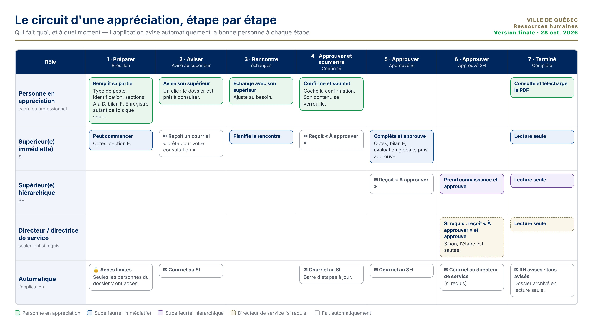

**Qui remplit quoi**

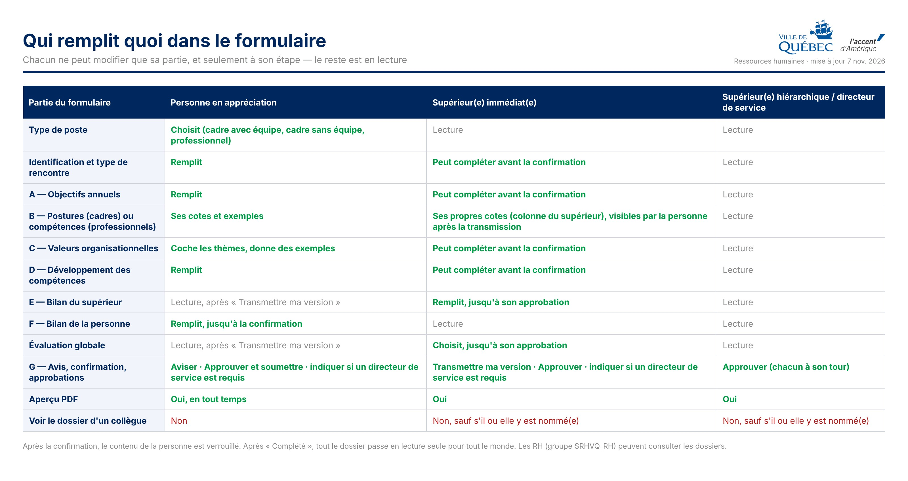

**Ce que l'outil fait en coulisses**

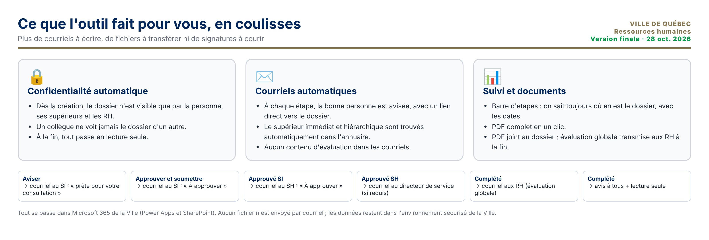

**Avantages par rapport au formulaire Word**

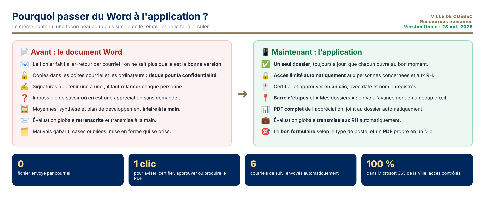

**Schéma de la solution** (document technique)

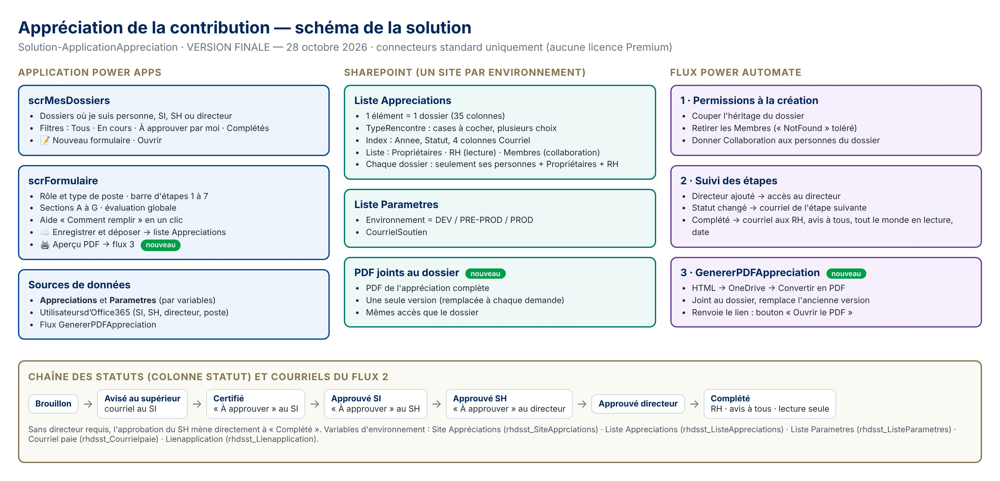

**Présentation aux gestionnaires** (3 premières diapositives sur 18)

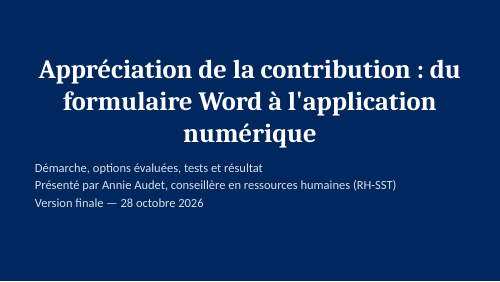

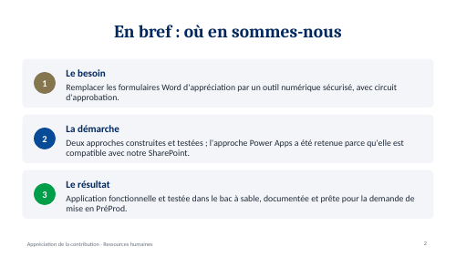

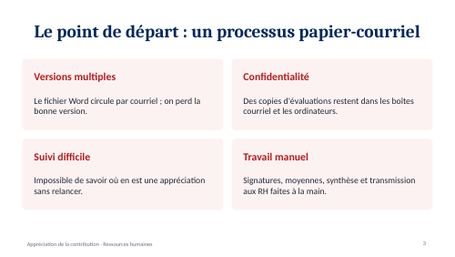

# 8. Textes de l'interface

| Endroit | Texte |
|---|---|
| Titre de l'application | Appréciation de la contribution |
| Sous-titre | Formulaire : Cadre avec équipe / Cadre sans équipe / Professionnel non syndiqué |
| Menu de gauche | 1. VOUS ÊTES : · 2. TYPE DE POSTE · ACTIONS |
| Rôles | Personne en appréciation · Supérieur(e) immédiat(e) · Supérieur(e) hiérarchique · Directeur / directrice |
| Boutons | Comment remplir ce formulaire · Enregistrer et déposer · Mes dossiers · Aperçu PDF · Ouvrir le PDF · Nouveau formulaire · + Ajouter une ligne · Aviser · Certifier · Approuver · À propos · Aide |
| Écran d'accueil | Mes dossiers · Rechercher un nom · Tous · En cours · À approuver par moi · Complétés · Ouvrir |
| Barre d'étapes | Brouillon · Certifié (personne en appréciation) · Approuvé (sup. immédiat) · Approuvé (sup. hiérarchique) · Approuvé (directeur) · Transmis aux RH · Archivé (lecture seule) |
| Messages | « Dossier enregistré. » · « Avant d'enregistrer, complétez : … » · « Créer votre dossier d'appréciation ? » · « Création du PDF en cours… Comptez de 10 à 30 secondes. » · « PDF prêt : cliquez sur « 📄 Ouvrir le PDF ». » · « Le PDF n'a pas pu être créé. Réessayez dans un moment. » |
| Objets des courriels | « Appréciation de [Nom] : prête pour votre consultation » · « À approuver : appréciation de [Nom] » · « Appréciation complétée – [Nom] » |

# 9. Contraintes techniques à connaître

- **Application Power Apps :** les couleurs et les polices sont modifiables. Une police institutionnelle doit être disponible dans Power Apps, ou installée sur les postes : sinon, une police de remplacement s'affiche.
- **PDF :** produit automatiquement à partir de HTML. Les polices se limitent à celles reconnues par le convertisseur de Microsoft (Segoe UI, Arial…).
- **Courriels :** texte simple, avec un lien. Aucune image.
- **Bandeau de marque :** une image. Elle peut être remplacée facilement par une version fournie par les Communications (PNG, environ 1000 × 200 px).

# 10. Grille de validation

Merci de remplir et de retourner cette grille à Annie Audet.

| Élément | Approuvé | Approuvé avec modifications | À revoir | Commentaires |
|---|---|---|---|---|
| Palette de couleurs | ☐ | ☐ | ☐ | |
| Contraste : vert action et gris libellés | ☐ | ☐ | ☐ | |
| Polices | ☐ | ☐ | ☐ | |
| Bandeau « On donne vie à la ville » (droits, version) | ☐ | ☐ | ☐ | |
| Bandeau or et titre | ☐ | ☐ | ☐ | |
| Boutons, pastilles et icônes | ☐ | ☐ | ☐ | |
| Logo de la Ville (à ajouter ou non) | ☐ | ☐ | ☐ | |
| PDF de l'appréciation | ☐ | ☐ | ☐ | |
| Visuels de communication (4 schémas) | ☐ | ☐ | ☐ | |
| Présentation aux gestionnaires | ☐ | ☐ | ☐ | |
| Textes de l'interface | ☐ | ☐ | ☐ | |

**Nom :** ______________________   **Service des communications**   **Date :** ______________
