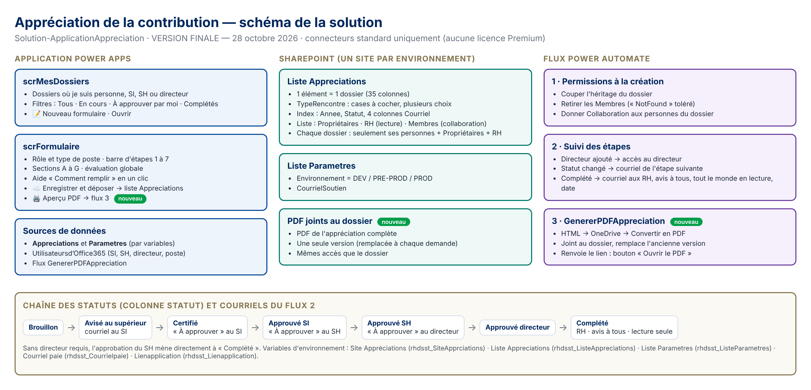

# 1. Identification

| | |
|---|---|
| **Application** | Appréciation de la contribution |
| **Acronyme** | SRHVQ |
| **Service** | Ressources humaines — Division de la santé et de la sécurité au travail (RHSST) |
| **Responsable fonctionnelle** | Annie Audet, conseillère en ressources humaines |
| **Soutien** | *[nom]* — *[téléphone]* — *[courriel]* (aussi affiché dans l'écran « À propos » de l'application) |
| **Utilisateurs** | Plus de 500 : cadres avec équipe, cadres sans équipe, professionnels non syndiqués et leurs gestionnaires ; équipe RH |
| **Solution** | Solution-ApplicationAppreciation (éditeur RH-DSST, préfixe rhdsst), **gérée** en PréProd et en Prod |
| **Licences** | Microsoft 365 seulement. **Connecteurs standard, aucune licence Premium** |

# 2. Objet et fonctionnalités

L'application remplace le formulaire Word d'appréciation de la contribution (version du 15 octobre 2026). Chaque appréciation est **un dossier** (un élément SharePoint), rempli par plusieurs personnes selon leur rôle, et suivi par un circuit d'approbation.

| Fonctionnalité | Description |
|---|---|
| Mes dossiers | Liste des dossiers où la personne connectée est la personne en appréciation, le SI, le SH ou le directeur. Filtres : Tous, En cours, À approuver par moi, Complétés. Recherche par nom |
| Formulaire | 3 formulaires selon le type de poste. Sections A (objectifs), B (postures de leadership à 4 niveaux, ou compétences), C (valeurs), D (développement), E (bilan du supérieur), F (bilan de la personne), G (approbations) |
| Rôle automatique | Le rôle (personne, SI, SH, directeur) est déduit du courriel de la personne connectée. Seules les sections de son rôle et de l'étape sont modifiables |
| Annuaire | Le SI et le SH sont trouvés automatiquement dans Office 365 (ManagerV2) à la création |
| Validation et confirmation | Les champs obligatoires sont vérifiés avant tout enregistrement. Une confirmation est demandée avant la création d'un dossier |
| Circuit | Brouillon › Avisé au supérieur › Certifié (contenu de la personne verrouillé) › Approuvé SI › Approuvé SH › (Approuvé directeur) › Complété |
| Barre d'étapes | Les 7 étapes, avec un ✓ et la date |
| Courriels automatiques | À chaque étape, la bonne personne reçoit un lien vers le dossier. Aucun contenu d'évaluation dans les courriels |
| Transmission aux RH | À « Complété » : l'évaluation globale seulement est transmise par courriel ; le dossier passe en lecture seule |
| PDF | PDF complet du dossier, joint au dossier (une seule version, remplacée à chaque demande) |
| À propos | Nom, version, environnement, responsable du soutien, téléphone, courriel, et formulaire pour écrire au soutien |
| Aide | Didacticiel de 5 pages (un par écran), et aide « Comment remplir ce formulaire » |

# 3. Architecture technique

## 3.1 Composants de la solution

| Composant | Nom | Rôle |
|---|---|---|
| Application canevas | Appréciation de la contribution | 4 écrans : scrMesDossiers, scrFormulaire, scrAPropos, scrAide (didacticiel) ; fenêtre de confirmation dans scrFormulaire |
| Flux 1 | Appréciation – Permissions à la création | À la création d'un dossier : coupe l'héritage, retire SRHVQ_Utilisateurs, donne Collaboration aux personnes du dossier |
| Flux 2 | Appréciation – Suivi des étapes | À chaque modification : courriels d'étape, accès du directeur, et à « Complété » : courriel aux RH, avis à tous, lecture seule, date de transmission |
| Flux 3 | GenererPDFAppreciation | Appelé par l'application : HTML › PDF (OneDrive du compte de service, fichier temporaire supprimé), joint au dossier |
| Références de connexion (6) | SharePoint Appreciations · Outlook Appreciations · Utilisateurs Office 365 Appreciations · OneDrive Entreprise RHDSSTDAAT-1b68d · SharePoint RHDSSTDAAT-11da3 · Office 365 Outlook Gestion_formulaire_approb… | Connexions du compte de service en PréProd et en Prod |
| Variables d'environnement | SRHVQ_SiteWeb-RHSST-AppreciationContribution · SRHVQ_Appreciations · SRHVQ_Parametres · SRHVQ_CourrielPaie · SRHVQ_LienApplication · SRHVQ_CourrielSoutien | Valeurs propres à chaque environnement ; **valeur non exportée** |

## 3.2 Données

| Liste | Contenu | Détail |
|---|---|---|
| SRHVQ_Appreciations | Un élément par dossier (34 colonnes + pièce jointe PDF) | SRHVQ_Matrice-metadonnees.xlsx |
| SRHVQ_Parametres | Paramètres de l'environnement (Environnement, CourrielSoutien, SupportNom, SupportTelephone) | Idem |

Les sections à plusieurs lignes (objectifs, postures, compétences, valeurs, développement) sont enregistrées en **JSON** dans des colonnes « Plusieurs lignes de texte brut », puis relues par l'application (ParseJSON).

## 3.3 Connecteurs

SharePoint, Utilisateurs d'Office 365, Office 365 Outlook, OneDrive Entreprise, Power Apps (déclencheur V2). Tous **standard**.

# 4. Pipeline : environnements et sites associés

| | Développement (bac à sable) | PréProd | Production |
|---|---|---|---|
| Environnement Power Platform | *[nom de l'environnement bac à sable]* | *[nom de l'environnement PréProd]* | *[nom de l'environnement Prod]* |
| Type de solution | **Non gérée** (modifications et tests) | **Gérée** | **Gérée** |
| Site SharePoint des données | https://villedequebec.sharepoint.com/sites/SandBoxAnnieAudet | **RH Power Apps Données PréProd** (*[adresse URL]*) | site de données Prod des TI (*[nom et adresse à confirmer, ex. « RH Power Apps Données Prod »]*) |
| Listes | Appreciations, Parametres | SRHVQ_Appreciations, SRHVQ_Parametres | SRHVQ_Appreciations, SRHVQ_Parametres |
| Groupe Entra d'application | Groupe de sécurité du bac à sable | G-IS-APP-*[xxxxx]* (PréProd) | G-IS-APP-*[xxxxx]* (Prod) |
| Groupes SharePoint locaux | SRHVQ_Utilisateurs, RH – Appréciations | SRHVQ_Utilisateurs, SRHVQ_RH | SRHVQ_Utilisateurs, SRHVQ_RH |
| Parametres › Environnement | DEV | PRE-PROD | PROD |
| Connexions | Développeuse | Compte de service | Compte de service |
| Utilisateurs | Développeuse, testeurs | Testeurs RH, TI | 500+ utilisateurs |

**Graduation d'une version :**

1. Modifier et tester **uniquement dans le bac à sable** (solution non gérée).
2. Augmenter la version de la solution. Vérifier que chaque variable d'environnement a la bascule **« Exporter la valeur » à Non**.
3. **Exporter en gérée**.
4. Les TI importent en **PréProd** (mise à niveau). Ils choisissent les connexions du compte de service et saisissent les valeurs des variables à la première importation.
5. Tests en PréProd (liste du guide de mise en production).
6. Les TI importent la **même** solution gérée en **Prod**.
7. Mettre à jour **SRHVQ_Revision-versions**.

# 5. Sécurité (résumé)

Le détail est dans **SRHVQ_Matrice-securite.xlsx**.

- **Accès à l'application :** groupe Entra G-IS-APP-xxxxx de l'environnement (sécurité de l'environnement et partage de l'application).
- **Accès aux données :** le groupe Entra est imbriqué dans le groupe SharePoint local **SRHVQ_Utilisateurs**. Ce groupe n'a aucun droit sur le site, et a **Collaboration** sur SRHVQ_Appreciations (pour créer son dossier) et **Lecture** sur SRHVQ_Parametres. Les Membres et Visiteurs du site sont retirés des listes.
- **Accès à chaque dossier :** autorisations uniques posées par le flux 1. Seuls y ont accès la personne, ses supérieurs, le directeur au besoin, **SRHVQ_RH** (Lecture) et les propriétaires. À « Complété », tout le monde passe en Lecture.
- **Courriels :** aucun contenu d'évaluation, sauf l'évaluation globale envoyée aux RH à la fin.

# 6. Cycle de vie des données

| Étape | Ce qui se passe | Qui |
|---|---|---|
| Création | Dossier créé au premier « Enregistrer et déposer », **après confirmation** ; autorisations uniques posées par le flux 1 | Personne en appréciation, flux 1 |
| Traitement | Remplissage et approbations ; historique des versions SharePoint | Personnes du dossier |
| Clôture | Statut « Complété » : lecture seule pour tous, évaluation globale transmise aux RH, date inscrite | Flux 2 |
| Conservation | Dossier et PDF conservés **[durée selon le calendrier de conservation — à confirmer avec la gestion documentaire]** | RH |
| Archivage | **[Proposé : à la fin de chaque année, déplacer les dossiers « Complété » de l'année dans une liste ou une bibliothèque d'archives en lecture seule — à valider avec les TI]** | RH / TI |
| Destruction | À l'échéance : suppression des dossiers et PDF par un propriétaire, **après confirmation écrite des RH** ; vidage de la corbeille ; inscription au registre de destruction **[procédure à confirmer]** | RH / propriétaires |

**Aucune suppression n'est possible dans l'application.** Les seules suppressions automatiques sont le **remplacement du PDF** par sa nouvelle version (flux 3) et le **fichier HTML temporaire** (flux 3).

# 7. Gestion des erreurs et soutien

| Où | Mécanisme |
|---|---|
| Application | **App.OnError** : message clair et invitation à joindre le soutien (À propos) ; Trace pour le diagnostic. L'enregistrement affiche l'erreur précise de SharePoint ; le PDF affiche un message s'il échoue |
| Validation | Champs obligatoires vérifiés avant tout enregistrement (message listant les champs manquants) |
| Flux | Étendue **Essayer** + action **Courriel erreur** (exécutée si échec ou délai dépassé) envoyée à **SRHVQ_CourrielSoutien**, avec le lien vers l'exécution en erreur |
| Soutien | Écran **À propos** : nom, téléphone, courriel du soutien et formulaire d'envoi de courriel |

# 8. Conformité aux exigences des TI

| N° | Exigence | Comment elle est respectée |
|---|---|---|
| 1 | Documentation dans Documents TI | Matrice de sécurité, matrice de métadonnées, ce document (architecture et pipeline), liste des utilisateurs, révision des versions |
| 2 | Fonctions commentées | Commentaire `//` au début de chaque formule d'action ; formules longues commentées par section |
| 3 | Formules lisibles | « Mettre en forme le texte » appliqué aux formules |
| 4 | Confirmation de création et de destruction | Fenêtre de confirmation avant la création d'un dossier ; aucune suppression dans l'application (voir partie 6) |
| 5 | Validation des champs | btnDeposer valide les champs obligatoires avant l'enregistrement |
| 6 | Gestion des erreurs | App.OnError, messages d'erreur, courriel d'erreur des flux au soutien |
| 7 | Écran À propos | scrAPropos, accessible depuis Mes dossiers et le formulaire, avec téléphone et formulaire de courriel |
| 8 | Écran d'aide (modèle Didacticiel) | scrAide : 5 pages décrivant chaque écran |
| 9 | Cycle de vie des données | Partie 6 ; durée de conservation et destruction à confirmer avec la gestion documentaire |
| 10 | Solution et variables d'environnement | Une solution gérée ; 6 variables nommées SRHVQ_… ; valeur non exportée ; listes SRHVQ_… |

# 9. Volumétrie et limites

| Élément | Estimation | Commentaire |
|---|---|---|
| Dossiers | ~500 par année | Autorisations uniques par dossier : prévoir l'archivage annuel (seuil recommandé d'environ 5 000 éléments à autorisations uniques par liste) |
| Exécutions de flux | ~10 à 15 par dossier par année | Flux 1 une fois ; flux 2 à chaque modification (arrêté rapidement si le statut ne change pas) ; flux 3 à chaque PDF |
| Seuil d'affichage | 5 000 éléments | Filtres sur colonnes indexées (Annee, Statut, courriels) |
