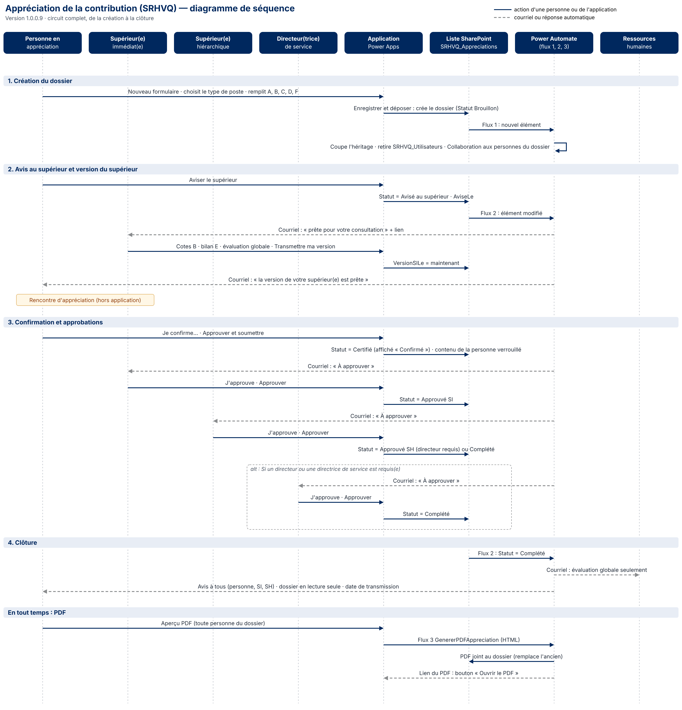

# 1. Comment lire la matrice RACI

| Lettre | Signification | Règle |
|---|---|---|
| **R** | **Réalise** : fait le travail | Au moins un R par activité |
| **A** | **Approuve** : rend des comptes, a le dernier mot | **Un seul A** par activité |
| **C** | **Consulté** avant ou pendant | Échange dans les deux sens |
| **I** | **Informé** après | Reçoit l'information (souvent un courriel automatique) |

Les cases marquées **[à valider]** sont des propositions : faites-les confirmer par votre direction et par les TI.

# 2. RACI du processus d'appréciation (dans l'application)

| Activité | Personne en appréciation | Sup. immédiat(e) | Sup. hiérarchique | Directeur(trice) de service | RH |
|---|---|---|---|---|---|
| Créer son dossier, choisir le type de poste | **R/A** | I | | | |
| Remplir sa partie (A, cotes B, C, D, F) | **R/A** | C | | | |
| Cocher « directeur(trice) de service requis(e) » | R | **A** | | I | |
| Aviser le supérieur immédiat | **R/A** | I | | | |
| Compléter cotes B, bilan E, évaluation globale | C | **R/A** | | | |
| Transmettre sa version à la personne | I | **R/A** | | | |
| Tenir la rencontre d'appréciation | R | **A** | | | |
| Confirmer et approuver le formulaire | **R/A** | I | | | |
| Approuver (1ᵉʳ niveau) | I | **R/A** | I | | |
| Approuver (2ᵉ niveau) | I | I | **R/A** | I | |
| Approuver (3ᵉ niveau, si requis) | I | I | I | **R/A** | |
| Recevoir et traiter l'évaluation globale | I | I | I | I | **R/A** |
| Produire le PDF du dossier | R | R | R | R | **A** [à valider] |

# 3. RACI de l'exploitation de la solution

| Activité | Responsable de l'application (RH-SST) | Équipe RH (SRHVQ_RH) | TI (Power Platform) | Propriétaires du site SharePoint |
|---|---|---|---|---|
| Modifications et nouvelles versions (bac à sable) | **R/A** | C | C | |
| Tests avant chaque mise en production | **R/A** | C | I | |
| Déploiement en PréProd et en Prod | C | | **R/A** | I |
| Variables d'environnement et références de connexion | C | | **R/A** | |
| Compte de service des flux | I | | **R/A** | |
| Accès à l'application (groupe Entra G-IS-APP-…) | **A** [à valider] | | R | |
| Membres du groupe SRHVQ_RH | **A** | I | | R |
| Groupes SharePoint et autorisations des listes | C | | C | **R/A** [à valider] |
| Surveillance des flux (échecs, courriels d'erreur) | **R/A** | | C | |
| Soutien aux utilisateurs, niveau 1 (« À propos ») | **R/A** | C | | |
| Soutien technique, niveau 2 | C | | **R/A** | |
| Conservation, archivage, destruction des dossiers | C | **R/A** [à valider] | C | R |
| Documentation (Documents TI) | **R/A** | | C | |

# 4. Diagramme de séquence

Le diagramme montre, dans l'ordre, **qui fait quoi** et **ce que le système fait tout seul** (flux, courriels), de la création à la clôture.

- **Trait plein** : action d'une personne ou de l'application.
- **Pointillé** : courriel ou réponse automatique.

# 5. Fichiers et comment les modifier (gratuit)

| Fichier | Usage |
|---|---|
| SRHVQ_RACI-et-sequence.docx | Ce document : modifiez les tableaux RACI directement dans Word |
| Diagramme-sequence.png / .jpg | Image à insérer dans un document ou une présentation |
| diagramme-sequence.svg | Même image, qualité parfaite à toute taille |
| diagramme-sequence.mmd | Source **Mermaid**, modifiable gratuitement (mermaid.live) |
| diagramme-sequence.drawio | Formes modifiables pour **draw.io**, d'où l'on exporte un fichier **Visio (.vsdx)** |
| generer-sequence.py | Source de l'image (pour la régénérer) |

**Modifier le diagramme sans logiciel payant :**

1. Ouvrez **https://mermaid.live** dans votre navigateur.
2. Effacez l'exemple, puis collez le contenu de **diagramme-sequence.mmd** (ouvrez-le avec le Bloc-notes).
3. Modifiez le texte : le diagramme se met à jour tout seul.
4. **Actions › PNG** ou **SVG** pour télécharger l'image.

Autre option : **draw.io** (gratuit) › **Organiser › Insérer › Mermaid** › collez le texte.

# 6. Utiliser le diagramme dans Visio

Visio **ne lit pas** les fichiers Mermaid (.mmd). Deux façons gratuites d'obtenir un fichier Visio :

**A. Fichier Visio modifiable (recommandé)**

1. Ouvrez **https://app.diagrams.net** (draw.io, gratuit, sans compte). Choisissez **Appareil** si on vous demande où enregistrer.
2. **Fichier › Ouvrir depuis › Appareil** › choisissez **diagramme-sequence.drawio**.
3. **Fichier › Exporter en › VSDX**. Enregistrez.
4. Ouvrez le fichier .vsdx dans Visio : chaque boîte, flèche et texte est une forme modifiable.

**B. Image dans Visio**

1. Visio › **Insérer › Images** › choisissez **diagramme-sequence.svg**.
2. Pour modifier : clic droit sur l'image › **Convertir en forme** (ou **Grouper › Dissocier**, selon la version de Visio).
